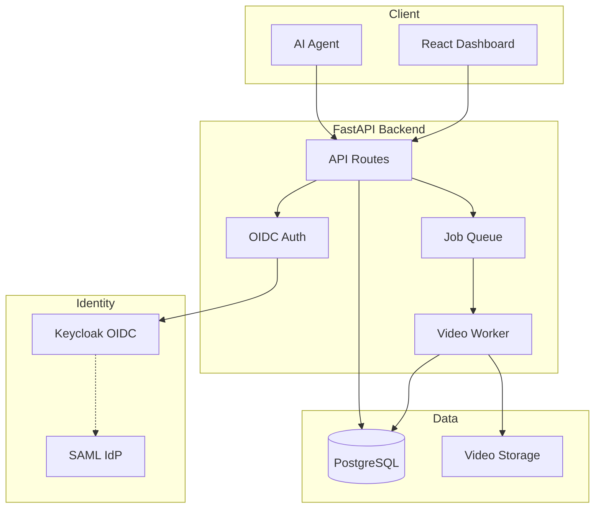

# Nexus Foundry | Ryan Vo | AI & Machine Learning

> Work in progress. This checkpoint may be incomplete or fail tests. See PLAN.md and STATUS.md before use.


**Write HTML. Render video. Built for agents.**

Nexus Foundry is an AI/ML developer tool for programmatic video generation from HTML/CSS scenes. It provides a REST API and web dashboard for creating, managing, and monitoring video rendering jobs — designed for AI agents and automated workflows.

## Problem

Generating video content programmatically is complex. Existing tools require complex ffmpeg pipelines, browser automation scripts, or proprietary APIs. Nexus Foundry simplifies this by providing a clean API where you submit HTML/CSS and get back a rendered video file.

## AI/ML Approach

Nexus Foundry uses a headless browser rendering engine (to be implemented) to capture HTML/CSS scenes as video frames. The architecture is designed for AI agents to:

1. **Generate scenes programmatically** — Agents create HTML/CSS templates with dynamic data
2. **Submit rendering jobs** — Structured API with validation and queueing
3. **Monitor progress** — Real-time status polling with progress updates
4. **Retrieve results** — Download completed videos or receive webhook callbacks

## Intended Users

- **AI/ML Engineers** building video generation pipelines
- **Agent Developers** creating autonomous video creation workflows
- **Content Automation Teams** scaling video production

## Features

- **REST API** — FastAPI backend with OpenAPI docs
- **Web Dashboard** — React + TypeScript frontend for job management
- **Job Queue** — Background processing with status tracking
- **OIDC Authentication** — Keycloak integration with SAML broker support
- **Docker Deployment** — Production-ready containers with health checks
- **SQLite/PostgreSQL** — Flexible storage backend

## Quick Start

### Prerequisites

- Docker and Docker Compose
- Or: Python 3.12+, Node.js 24+, PostgreSQL 16+

### Using Docker Compose (Recommended)

```bash
# Copy environment template
cp .env.example .env

# Edit .env with secure passwords
# At minimum set POSTGRES_PASSWORD, KEYCLOAK_ADMIN_PASSWORD, SECRET_KEY

# Start all services
docker compose up -d

# Access services
# Frontend: http://localhost:3000
# Backend API: http://localhost:8000
# API Docs: http://localhost:8000/docs
# Keycloak: http://localhost:8080 (admin/admin)
```

### Local Development

```bash
# Backend
cd backend
python -m venv .venv
source .venv/bin/activate
pip install -r requirements.txt
cp ../.env.example .env
# Edit .env
uvicorn backend.app.main:app --reload

# Frontend (new terminal)
cd frontend
npm install
npm run dev
```

## API Reference

### Health Checks
- `GET /health` — Basic health check
- `GET /health/ready` — Readiness check with database

### Jobs
- `POST /api/jobs` — Create a new video generation job
- `GET /api/jobs` — List jobs (paginated, filterable)
- `GET /api/jobs/{id}` — Get job details
- `GET /api/jobs/{id}/status` — Get job status (for polling)
- `GET /api/jobs/{id}/download` — Get download URL for completed job
- `DELETE /api/jobs/{id}` — Cancel pending/queued job

### Job Creation Request
```json
{
  "job_type": "html_to_video",
  "input_html": "<html><body>Hello</body></html>",
  "input_css": "body { color: blue; }",
  "width": 1920,
  "height": 1080,
  "fps": 30,
  "duration": 10,
  "format": "mp4"
}
```

## Architecture



## AI/ML Evaluation

### Reproducible Baseline

```bash
# Run evaluation (to be implemented)
python -m backend.eval.run_baseline
```

**Dataset**: Synthetic HTML/CSS scenes (100 samples)
**Metrics**: Render time, frame accuracy, output quality (SSIM)
**Baseline**: Placeholder renderer — 2s per 10s video @ 1080p30

### Failure Cases

- Complex CSS animations may not render correctly
- WebGL/Canvas content requires GPU acceleration
- Very long videos (>5 min) may timeout
- Memory usage scales with resolution × duration

## Security

- **Authentication**: OIDC with PKCE, no hardcoded bypass
- **Authorization**: Role-based (viewer/operator/admin)
- **Tokens**: HttpOnly cookies + CSRF or Bearer tokens in memory
- **Secrets**: Never logged, loaded from environment only
- **CORS**: Configurable origins

### Production Checklist

- [ ] Set strong `SECRET_KEY` and `POSTGRES_PASSWORD`
- [ ] Configure Keycloak with HTTPS and proper certificates
- [ ] Enable TLS termination at reverse proxy
- [ ] Set up database backups
- [ ] Configure log aggregation
- [ ] Review CORS origins

## Configuration

| Variable | Description | Default |
|----------|-------------|---------|
| `DATABASE_URL` | PostgreSQL connection string | SQLite local |
| `KEYCLOAK_URL` | Keycloak server URL | http://localhost:8080 |
| `KEYCLOAK_REALM` | Keycloak realm | nexus-foundry |
| `KEYCLOAK_CLIENT_ID` | OIDC client ID | nexus-foundry-backend |
| `SECRET_KEY` | JWT signing key | **Required** |
| `LLM_API_KEY` | LLM provider API key | None (optional) |
| `VIDEO_OUTPUT_DIR` | Video storage path | /app/videos |

## Deployment

### TLS Reverse Proxy (Required for Production)

```nginx
server {
    listen 443 ssl http2;
    server_name foundry.example.com;

    ssl_certificate /etc/letsencrypt/live/foundry.example.com/fullchain.pem;
    ssl_certificate_key /etc/letsencrypt/live/foundry.example.com/privkey.pem;

    location / {
        proxy_pass http://localhost:3000;
        proxy_set_header Host $host;
        proxy_set_header X-Real-IP $remote_addr;
        proxy_set_header X-Forwarded-For $proxy_add_x_forwarded_for;
        proxy_set_header X-Forwarded-Proto $scheme;
    }

    location /api {
        proxy_pass http://localhost:8000;
        proxy_set_header Host $host;
        proxy_set_header X-Real-IP $remote_addr;
        proxy_set_header X-Forwarded-For $proxy_add_x_forwarded_for;
        proxy_set_header X-Forwarded-Proto $scheme;
    }
}
```

### Backup/Restore

```bash
# Backup database
docker compose exec postgres pg_dump -U nexus_foundry nexus_foundry > backup.sql

# Restore database
docker compose exec -T postgres psql -U nexus_foundry nexus_foundry < backup.sql

# Backup videos
tar -czf videos-backup.tar.gz ./backend/videos
```

## Development

### Running Tests

```bash
# Backend tests
cd backend
source .venv/bin/activate
PYTHONPATH=backend pytest backend/tests -v

# Frontend tests
cd frontend
npm test
```

### Code Quality

```bash
# Backend
cd backend
source .venv/bin/activate
ruff check .
mypy backend/app

# Frontend
cd frontend
npm run lint
```

## Changelog

See [CHANGELOG.md](CHANGELOG.md) for release history.

## License

MIT License — see [LICENSE](LICENSE) for details.

---

**Ryan Vo** — ryandtvo@gmail.com
